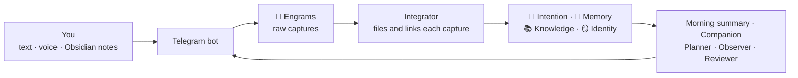

<p align="center"></p>

<h1 align="center">Seahorse</h1>

<p align="center">An external hippocampus. You talk to it on Telegram. It keeps your life in an Obsidian vault, plans your week, and starts conversations with you.</p>

---

## What Seahorse is

Seahorse is a second brain that works for you, not a second brain that you must maintain.

- **You only capture.** You send a text or a voice note on Telegram, or you write a note in Obsidian. That is all you do.
- **AI agents do the rest.** They file each capture in the right place, link it to what you already know, turn actions into tasks, and plan your week.
- **It talks first.** Each day it asks how your day was, tells you about new releases you would like, asks about a project that went quiet, and reminds you of real deadlines.
- **Everything stays yours.** Your vault is plain Markdown in a private Git repository. You can read and edit every note in Obsidian.

The name comes from the hippocampus: the part of the brain that takes in what you live and turns it into long-term memory. In Greek, *hippocampus* means seahorse.

<p align="center"></p>

## The idea: the areas of the mind

Most second-brain systems organize files. Seahorse organizes a person. It splits what you are into four areas, in the order of how memory works: what you will do, what happened, what you know, and who you are.

| Area | What it holds | The question it answers |
|---|---|---|
| **🎯 Intention** | Tasks, the week, goals, and the things you want to watch, read, play, visit or buy | What will I do? |
| **📓 Memory** | Your journal, trips, career, the people in your life, and what you watched, read and visited | What happened? |
| **📚 Knowledge** | One folder for each subject: your projects, your studies, what you build | What do I know? |
| **🪞 Identity** | Your profile, your routine, your patterns, your tastes, your traits | Who am I? |

Two more folders support them:

- **💭 Engrams** keep each capture exactly as you sent it. An engram is the raw trace of a memory. Agents never change its text, so each claim in the vault points to your own words.
- **⚙️ System** holds the rules the agents follow, in plain language. You can read them, and you can change them.

### Why these four areas help

- **A new fact changes old notes.** When you say "I started a new job", Seahorse does not only save the sentence. It updates your career, your Identity, your routine, and the people involved. Integrating is not appending.
- **Actions live in one place.** Any action, from any capture, ends in Intention. Subject notes never hide a to-do list. You always know where to look.
- **Identity is a hypothesis until there is evidence.** Seahorse infers your patterns from what you do, not from what you say you value. A trait starts as a hypothesis, becomes "supported" after three separate signals, and becomes "confirmed" only when you agree.
- **The vault is alive.** Agents rewrite summaries, merge duplicates, move finished wishes to Memory, and learn which messages you like. Nothing is deleted: old understanding moves to a History section.

## How it compares

Seahorse borrows from well-known methods. This table shows what it keeps from each, and what it adds.

| Method | What Seahorse keeps | What Seahorse adds |
|---|---|---|
| **GTD** (Getting Things Done) | Capture everything, process an inbox, plan the week | The processing and the weekly plan are automatic. Unfinished tasks move to the next free day by themselves. Real deadlines get reminders |
| **PARA** (Projects, Areas, Resources, Archives) | Projects separate from reference material | The top level follows the mind, not the type of file. Memory and Identity have their own places, and PARA has no place for "who I am" |
| **Zettelkasten** | Atomic notes and dense links | The agents make the links when you capture something. You do not need to file or link by hand |
| **Building a Second Brain** (CODE) | Capture, organize, distill, express | You only do the first step. The agents organize and distill. Seahorse brings ideas back to you, unasked |
| **"Chat with your notes" tools** | Ask questions about your notes | Seahorse does not wait for questions. It keeps the vault current, and it starts conversations: check-ins, suggestions, deadlines |
| **AI-maintained wikis** (the "LLM wiki" idea) | An AI that keeps a Markdown knowledge base | Each claim cites the engram it came from, your own notes are never rewritten, and a validator checks the vault after each run |

In short: other systems give you a better place to store things. Seahorse gives you a partner that remembers, organizes and comes back to you.

## How it works



| Agent | When | What it does |
|---|---|---|
| **Integrator** | Seconds after each message | Puts each capture in the right notes, creates tasks, and tells you in one line what it did |
| **Notes reader** | Every 5 minutes | Reads the notes you write in Obsidian, after 15 quiet minutes, and connects them. It never changes your text |
| **Morning summary** | Every morning (08:00 by default) | Today's tasks, moved tasks, next deadlines, what changed, and what needs you. The week image follows it |
| **Companion** | 1 to 4 random moments a day, plus a check-in at night | Asks about your day, brings new releases and news you would like, revives quiet projects, asks about tasks you keep moving |
| **Messenger** | Every 10 minutes | Sends deadline reminders and what Seahorse promised. Never during your quiet hours |
| **Planner** | Sunday | Builds the next week from your tasks and your real daily capacity |
| **Observer** | Sunday | Finds patterns and updates Identity |
| **Reviewer** | Every night | Fixes errors, merges duplicates, and checks each note against its sources |

## What you need

| You need | Why | Cost |
|---|---|---|
| **Telegram** | It is how you talk to Seahorse | Free |
| **Obsidian** | It is how you read and edit your vault | Free |
| **An AI**: Claude or ChatGPT | The agents run on it | A Claude Pro/Max or ChatGPT Plus/Pro subscription that you may already have, or an API key that you pay per use |
| **A machine that is always on** | The bot must answer and the agents must run at night | A small server (VPS) costs about US$5 a month. Your own computer works too, but only while it is on |
| **GitHub** (optional) | To sync your vault to your phone and laptop | Free |
| **Groq** (optional) | Fast, free transcription of voice notes | Free |

## Before you install

You do three things before the install. If you never used a server or a terminal, follow the guides below. Each step tells you what to click and what to type.

### 1. Choose where Seahorse runs

Seahorse must stay on: it answers your messages and its agents work at night.

| | A server (VPS) | Your own computer |
|---|---|---|
| **On day and night** | Yes | Only while the computer is on and awake |
| **Cost** | About US$5 a month | Free |
| **Best for** | Daily use | A first test |

You can start on your computer and move to a server later.

### 2. Open a terminal on that machine

A terminal is a window where you type commands. Pick the guide for your choice:

<details>
<summary><b>Rent a server (VPS) on Hetzner and connect to it</b></summary>

Any provider with Ubuntu works, such as Hetzner, DigitalOcean or Oracle Cloud. These steps use Hetzner.

1. Create an account at <https://www.hetzner.com/cloud>, then open the Cloud Console at <https://console.hetzner.cloud>.
2. Open your project (or create one) and click **Add Server**.
3. Choose these options:
   - **Location**: the one nearest to you.
   - **Image**: **Ubuntu** (the newest version, such as 24.04).
   - **Type**: the smallest and cheapest type. Seahorse needs little power.
   - **SSH key**: you can skip it. Then Hetzner sends the password of the server to your email.
4. Click **Create & Buy now**. After a few seconds, the server shows its **IPv4 address**, such as `203.0.113.10`. Copy it.
5. Open a terminal on your own computer:
   - **Windows**: open the Start menu, type `PowerShell`, and open it.
   - **Mac**: press `Cmd + Space`, type `Terminal`, and open it.
6. Type this command with your address, and press Enter:

   ```bash
   ssh root@203.0.113.10
   ```

7. The first time, it asks "Are you sure you want to continue connecting?". Type `yes` and press Enter.
8. Paste the password from the email and press Enter. **The password does not show while you type or paste. This is normal.** The server can ask you to choose a new password.

When you see a line that ends in `#`, you are on the server. Keep this window open for the install. To come back later, run the same `ssh` command.

</details>

<details>
<summary><b>Use your own Mac or Linux computer</b></summary>

- **Mac**: press `Cmd + Space`, type `Terminal`, and open it.
- **Linux**: open the Terminal app.

Seahorse stops while the computer sleeps. On a Mac, to keep it awake on the power adapter, open *System Settings → Battery → Options* (or *Energy*) and turn on *Prevent automatic sleeping when the display is off*.

</details>

<details>
<summary><b>Use your own Windows computer</b></summary>

Seahorse runs in Linux, so on Windows it runs inside WSL (Windows Subsystem for Linux). WSL is free and comes from Microsoft.

1. Open the Start menu, type `PowerShell`, right-click it, and choose **Run as administrator**.
2. Run this command, then restart the computer:

   ```bash
   wsl --install
   ```

3. After the restart, open **Ubuntu** from the Start menu. The first time, it asks for a new user name and password for Linux. Choose any.
4. Use this Ubuntu window for the install.

Seahorse stops while Windows sleeps. To open your notes in Obsidian on Windows, choose the GitHub sync in step 7 of the setup.

</details>

### 3. Have these ready

- **Your phone, with Telegram installed and logged in.** During the setup you create your private bot with @BotFather, the official Telegram bot that makes bots. The setup shows each step.
- **A Claude account (Pro or Max plan) or a ChatGPT account (Plus or Pro plan).** An API key also works.
- **Optional: a GitHub account** (free, at <https://github.com/signup>), to open your notes on your phone and on other computers.

## Install

In the terminal of the machine that will run Seahorse, run:

```bash
curl -fsSL https://raw.githubusercontent.com/lorenzoa7/seahorse/main/install.sh | bash
```

The installer installs `uv` and Seahorse, then starts a setup that asks one thing at a time. It takes about 15 minutes. First it asks your language: English, Português (Brasil) or Español. After that, it speaks your language.

To answer, use the arrow keys and Enter, or type and press Enter. To paste in a terminal, right-click, or press `Ctrl + Shift + V` (`Cmd + V` on a Mac).

| Step | What it asks | What you do |
|---|---|---|
| 1. **Where** | A server or your own computer | Choose one |
| 2. **About you** | Your first name and where you live | Type your name and choose your city. The setup shows your local time, so you can check it |
| 3. **The AI** | Which account you have | Choose it. The setup installs the AI tool and shows a link. Open the link on any device, even your phone, log in, and paste the code it gives you. Then the setup tests the AI |
| 4. **Telegram** | A token for your bot | On your phone, follow the steps the setup shows: talk to @BotFather, send `/newbot`, choose a name and a user name. Paste the token that BotFather sends. Then open the link to your new bot and tap **Start**. The setup finds you by itself |
| 5. **Voice notes** | How to turn voice into text | Choose Groq (free, recommended). The setup shows how to get a free key at <https://console.groq.com/keys> |
| 6. **Your routine** | Your free hours a day, the tag of work tasks, the time of the morning summary, and the end of the quiet hours | Press Enter to keep each suggestion, or type a new value |
| 7. **The vault** | Where your notes live, and where you will open them | Press Enter to keep the folder. To use your phone, choose GitHub and then *Automatically*: the setup shows a code, you type it at <https://github.com/login/device>, and the setup creates a private repository for you |
| 8. **Background** | Nothing | The setup starts Seahorse, which also starts again after a reboot. Seahorse sends you a first message on Telegram |

<details>
<summary><b>Create the Telegram bot (step 4), with more detail</b></summary>

Your bot is a private Telegram account that Seahorse controls. Only you can talk to it: Seahorse ignores all other people.

1. On your phone, open Telegram and search for `@BotFather`. Choose the one with the blue check mark. Or open <https://t.me/BotFather>.
2. Tap **Start**. Then send `/newbot`.
3. BotFather asks for a name. This is the name you see in your chats. Send any name, such as `My Seahorse`.
4. BotFather asks for a user name. It must end in `bot`, and nobody else can have it. Send one such as `ada_seahorse_bot`. If BotFather says it is taken, try another.
5. BotFather sends a message with a token, a line such as `7123456789:AAH4k-xyz…`. Tap it to copy it, and paste it in the setup. If your phone and the terminal are on different devices, send the token to yourself (for example, in Telegram's *Saved Messages*) and copy it on the computer.
6. The setup shows a link such as `https://t.me/ada_seahorse_bot`. Open it and tap **Start**.

The token is the password of your bot. Do not share it. If somebody sees it, send `/revoke` to @BotFather and run `seahorse setup` again with the new token.

To give your bot a picture, send `/setuserpic` to @BotFather.

</details>

If a step fails, the setup tells you what to do. Your answers are saved after each step: run `seahorse setup` again, and it asks to keep what already works. Run `seahorse doctor` to check each part.

## Open your vault in Obsidian

Obsidian is a free app for notes: <https://obsidian.md>.

### On the computer that runs Seahorse

In Obsidian, choose *Open folder as vault* and pick the vault folder (`~/seahorse-vault` by default).

### Open your vault on your phone

This needs the GitHub sync from step 7 of the setup.

1. **Make a key for the phone.** On GitHub, open <https://github.com/settings/personal-access-tokens/new>.
   - **Token name**: `Obsidian phone`.
   - **Expiration**: the longest one. When it ends, make a new key.
   - **Repository access**: *Only select repositories*, and choose your vault repository.
   - **Permissions → Repository permissions → Contents**: *Read and write*.
   - Click **Generate token** and copy the token.
2. **Install Obsidian** on your phone and create a new empty vault, such as `Seahorse`.
3. **Install the Git plugin.** In Obsidian, open *Settings → Community plugins*, turn them on, tap *Browse*, search for **Git** (by Vinzent), install it, and enable it.
4. **Log in.** In *Settings → Git*, find *Authentication*. Type your GitHub user name, and paste the token as the password.
5. **Get your notes.** Open the command palette (swipe down, or tap the `>` button) and run *Git: Clone an existing remote repo*.
   - URL: `https://github.com/YOUR-USER/seahorse-vault.git` (with your user name and repository name).
   - Folder: leave it empty, so the notes go in the vault root.
   - When it asks if the repository has a `.obsidian` folder, answer *Yes*.
   - When it finishes, close Obsidian and open it again.
6. **Keep it in sync.** In *Settings → Git*, set *Auto commit-and-sync interval* to `1`, set *Auto pull interval* to `1`, and turn on *Pull on startup*.

Now Seahorse sees the notes you write and the boxes you check, and you see what Seahorse writes.

### On another computer

1. Install Git from <https://git-scm.com>.
2. In a terminal, run this command with your user name and repository name:

   ```bash
   git clone https://github.com/YOUR-USER/seahorse-vault.git
   ```

   On Windows, a browser window opens to log in to GitHub. On a Mac or Linux, type your GitHub user name, and paste a token as the password (make one as in step 1 above).
3. In Obsidian, choose *Open folder as vault* and pick the new `seahorse-vault` folder.
4. Install the **Git** plugin and set the sync as in steps 3 and 6 above.

### In each vault

The vault comes ready: a Dashboard with the week and the task table, tables for movies, series, books, games, places and purchases, and a CSS snippet for the week view. In *Settings → Appearance → CSS snippets*, make sure `seahorse` is on.

Keep big files out of the vault. On a phone, the Git plugin loads the repository into memory, and large images can make Obsidian close.

## Use it

- **Capture anything.** Send text or a voice note: "Pay the car tax by the 15th", "I watched Dune, loved it", "Idea for the app: offline mode". Each message gets a short confirmation that says where it went.
- **Ask anything.** "When is my dentist appointment?" gets an answer from your vault.
- **See the week.** Send only `week` to get the image of the week, or `today` for the image of today. The words follow your language: `semana` and `hoje` in Portuguese, `semana` and `hoy` in Spanish.
- **Answer the Companion.** Reply to its messages with text or voice. Most messages have only an `Ignore` button. One-tap buttons appear only when one tap fully answers, such as "Add to my list".
- **Write in Obsidian.** Write any note, anywhere. Seahorse reads it after 15 quiet minutes, connects it to the rest, and marks it as yours. It never changes your text.

### Bot commands

| Command | What it does |
|---|---|
| `/status` | Shows how many captures are pending, and the version |
| `/integrate` | Integrates the pending captures now |
| `/update` | Installs the newest version, if there is one |

### Terminal commands

| Command | What it does |
|---|---|
| `seahorse setup` | Sets up Seahorse, or changes a setting |
| `seahorse doctor` | Checks each part and says what to fix |
| `seahorse status` | Shows what is running |
| `seahorse update` | Installs the newest release |
| `seahorse logs` | Shows the command to read the logs |
| `seahorse agent <name>` | Runs one agent now: `integrator`, `notes`, `morning`, `reviewer`, `weekly`, `messenger` |
| `seahorse capture` | Saves text from the standard input as a capture |

## Updates

When a new version is out, the bot sends you its release notes once. To install it, send `/update` to the bot or run `seahorse update`. The update installs the new code, applies the vault changes of that version, and restarts Seahorse. It never changes the text of your notes.

Each version is a [GitHub release](https://github.com/lorenzoa7/seahorse/releases), with its notes in [CHANGELOG.md](CHANGELOG.md).

## Settings

The setup writes two files in `~/.seahorse`:

- `config.toml`: your name, language, time zone, AI provider, schedule and capacity.
- `secrets.env`: the tokens and keys. Only your user can read it.

```toml
[user]
name = "Ada"
language = "en"            # en, pt-BR or es
timezone = "Europe/Lisbon"

[ai]
provider = "claude"        # claude or codex

[ai.models]                # optional: a model for each tier
# fast = "haiku"
# standard = "sonnet"
# deep = "opus"

[vault]
path = "/home/ada/seahorse-vault"

[telegram]
user_id = 123456789

[schedule]
morning = "08:00"
reviewer = "03:30"
weekly_day = "sun"
weekly_time = "18:00"
quiet_from = "00:00"
quiet_until = "08:00"

[week]
daily_capacity = "4h"
work_tag = "work"
```

The rules the agents follow are in your vault, in `6. ⚙️ System/`. They are plain language. If an agent does something you do not like, change the rule.

## Privacy and costs

- Your vault is plain Markdown in your own Git repository. Seahorse has no server and collects no data.
- The AI provider you choose (Anthropic or OpenAI) receives the notes that the agents read, under the terms of your account.
- With a subscription, Seahorse uses the limits of your plan. A normal day uses a few dozen agent runs. The weekly planning uses the deepest model once a week.
- If you choose Groq, Groq receives your voice notes to transcribe them.

## Languages

The setup, the bot and the agents support English, Brazilian Portuguese and Spanish. The folder names and the agent rules stay in English for every language. Your notes and the messages you get use your language.

To add a language, copy `seahorse/i18n/en.toml`, translate the values, and open a pull request.

## Contributing

Issues and pull requests are welcome. Run the tests with:

```bash
uv run python -m unittest discover -s tests
```

## License

MIT
