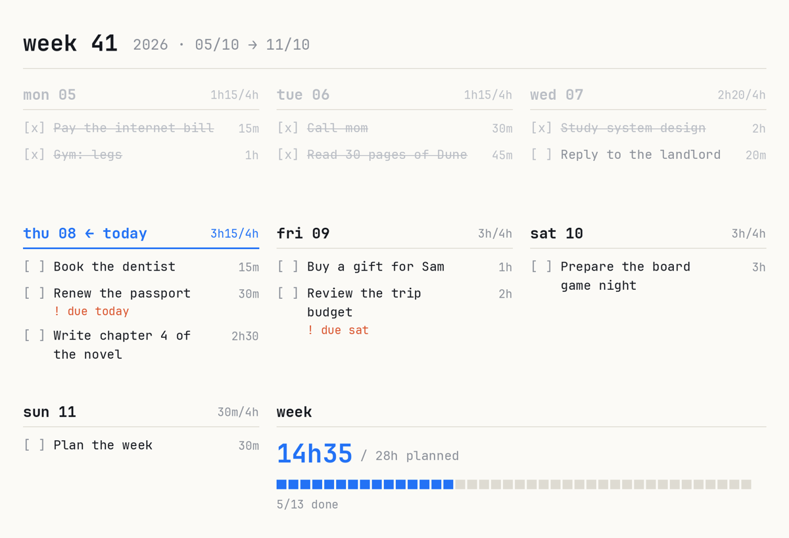
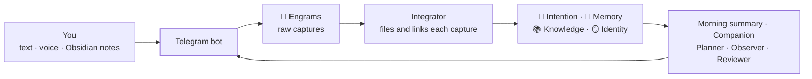

<p align="center"></p>

<h1 align="center">Seahorse</h1>

<p align="center">An external hippocampus. You talk to it on Telegram. It keeps your life in an Obsidian vault, plans your week, and starts conversations with you.</p>

---

## What Seahorse is

Seahorse is a second brain that works for you, not a second brain that you must maintain.

- **You only capture.** You send a text or a voice note on Telegram, or you write a note in Obsidian. That is all you do.
- **AI agents do the rest.** They file each capture in the right place, link it to what you already know, turn actions into tasks, and plan your week.
- **It talks first.** Each day it asks how your day was, tells you about new releases you would like, asks about a project that went quiet, and reminds you of real deadlines.
- **Everything stays yours.** Your vault is plain Markdown in a private Git repository. You can read and edit every note in Obsidian.

The name comes from the hippocampus: the part of the brain that takes in what you live and turns it into long-term memory. In Greek, *hippocampus* means seahorse.

<p align="center"></p>

## The idea: the areas of the mind

Most second-brain systems organize files. Seahorse organizes a person. It splits what you are into four areas, in the order of how memory works: what you will do, what happened, what you know, and who you are.

| Area | What it holds | The question it answers |
|---|---|---|
| **🎯 Intention** | Tasks, the week, goals, and the things you want to watch, read, play, visit or buy | What will I do? |
| **📓 Memory** | Your journal, trips, career, the people in your life, and what you watched, read and visited | What happened? |
| **📚 Knowledge** | One folder for each subject: your projects, your studies, what you build | What do I know? |
| **🪞 Identity** | Your profile, your routine, your patterns, your tastes, your traits | Who am I? |

Two more folders support them:

- **💭 Engrams** keep each capture exactly as you sent it. An engram is the raw trace of a memory. Agents never change its text, so each claim in the vault points to your own words.
- **⚙️ System** holds the rules the agents follow, in plain language. You can read them, and you can change them.

### Why these four areas help

- **A new fact changes old notes.** When you say "I started a new job", Seahorse does not only save the sentence. It updates your career, your Identity, your routine, and the people involved. Integrating is not appending.
- **Actions live in one place.** Any action, from any capture, ends in Intention. Subject notes never hide a to-do list. You always know where to look.
- **Identity is a hypothesis until there is evidence.** Seahorse infers your patterns from what you do, not from what you say you value. A trait starts as a hypothesis, becomes "supported" after three separate signals, and becomes "confirmed" only when you agree.
- **The vault is alive.** Agents rewrite summaries, merge duplicates, move finished wishes to Memory, and learn which messages you like. Nothing is deleted: old understanding moves to a History section.

## How it compares

Seahorse borrows from well-known methods. This table shows what it keeps from each, and what it adds.

| Method | What Seahorse keeps | What Seahorse adds |
|---|---|---|
| **GTD** (Getting Things Done) | Capture everything, process an inbox, plan the week | The processing and the weekly plan are automatic. Unfinished tasks move to the next free day by themselves. Real deadlines get reminders |
| **PARA** (Projects, Areas, Resources, Archives) | Projects separate from reference material | The top level follows the mind, not the type of file. Memory and Identity have their own places, and PARA has no place for "who I am" |
| **Zettelkasten** | Atomic notes and dense links | The agents make the links when you capture something. You do not need to file or link by hand |
| **Building a Second Brain** (CODE) | Capture, organize, distill, express | You only do the first step. The agents organize and distill. Seahorse brings ideas back to you, unasked |
| **"Chat with your notes" tools** | Ask questions about your notes | Seahorse does not wait for questions. It keeps the vault current, and it starts conversations: check-ins, suggestions, deadlines |
| **AI-maintained wikis** (the "LLM wiki" idea) | An AI that keeps a Markdown knowledge base | Each claim cites the engram it came from, your own notes are never rewritten, and a validator checks the vault after each run |

In short: other systems give you a better place to store things. Seahorse gives you a partner that remembers, organizes and comes back to you.

## How it works



| Agent | When | What it does |
|---|---|---|
| **Integrator** | Seconds after each message | Puts each capture in the right notes, creates tasks, and tells you in one line what it did |
| **Notes reader** | Every 5 minutes | Reads the notes you write in Obsidian, after 15 quiet minutes, and connects them. It never changes your text |
| **Morning summary** | Every morning (08:00 by default) | Today's tasks, moved tasks, next deadlines, what changed, and what needs you. The week image follows it |
| **Companion** | 1 to 4 random moments a day, plus a check-in at night | Asks about your day, brings new releases and news you would like, revives quiet projects, asks about tasks you keep moving |
| **Messenger** | Every 10 minutes | Sends deadline reminders and what Seahorse promised. Never during your quiet hours |
| **Planner** | Sunday | Builds the next week from your tasks and your real daily capacity |
| **Observer** | Sunday | Finds patterns and updates Identity |
| **Reviewer** | Every night | Fixes errors, merges duplicates, and checks each note against its sources |

## What you need

| You need | Why | Cost |
|---|---|---|
| **Telegram** | It is how you talk to Seahorse | Free |
| **Obsidian** | It is how you read and edit your vault | Free |
| **An AI**: Claude or ChatGPT | The agents run on it | A Claude Pro/Max or ChatGPT Plus/Pro subscription that you may already have, or an API key that you pay per use |
| **A machine that is always on** | The bot must answer and the agents must run at night | A small server (VPS) costs about US$5 a month. Your own computer works too, but only while it is on |
| **GitHub** (optional) | To sync your vault to your phone and laptop | Free |
| **Groq** (optional) | Fast, free transcription of voice notes | Free |

**Where to run it.** A VPS is the best choice: it is on day and night, and the setup takes 10 minutes. Any provider with Ubuntu works, such as Hetzner, DigitalOcean or Oracle Cloud (free tier). Your own Mac or Linux computer also works, but Seahorse stops when the computer sleeps. On Windows, install it inside WSL.

## Install

Open a terminal on the machine that will run Seahorse (on a VPS, connect with `ssh` first) and run:

```bash
curl -fsSL https://raw.githubusercontent.com/lorenzoa7/seahorse/main/install.sh | bash
```

The installer installs `uv` and Seahorse, then starts a setup that asks one thing at a time. It starts in English, and after the first question it speaks your language.

1. **Language**: English, Português (Brasil) or Español. The bot and your notes use it.
2. **About you**: your first name and time zone.
3. **The AI**: Claude or Codex, with a subscription or an API key. The setup installs the tool, opens the login, and tests it.
4. **The Telegram bot**: you create your private bot with @BotFather and paste its token. Then you press Start on your phone, and the setup finds your Telegram account by itself.
5. **Voice notes**: Groq (free key), a local model, or none.
6. **Your routine**: your free hours a day, the tag of work tasks, the time of the morning summary, and the quiet hours.
7. **The vault**: Seahorse creates it. To use it on other devices, you give it an empty private GitHub repository and add the deploy key it shows.

At the end, Seahorse runs in the background, starts again after a reboot, and sends you a first message on Telegram.

You can run `seahorse setup` again at any time to change an answer. It keeps the answers you do not change.

## Open your vault in Obsidian

- **On the same computer:** in Obsidian, choose *Open folder as vault* and pick the vault folder.
- **On other devices (phone, laptop):** clone your private vault repository, open it in Obsidian, and install the community plugin **Obsidian Git**. Set it to pull, and to commit and sync, every minute. Seahorse sees the notes you write and the boxes you check.

The vault comes ready: a Dashboard with the week and the task table, tables for movies, series, books, games, places and purchases, and a CSS snippet for the week view. In *Settings → Appearance → CSS snippets*, make sure `seahorse` is on.

Keep big files out of the vault. On a phone, Obsidian Git loads the repository into memory, and large images can make it close.

## Use it

- **Capture anything.** Send text or a voice note: "Pay the car tax by the 15th", "I watched Dune, loved it", "Idea for the app: offline mode". Each message gets a short confirmation that says where it went.
- **Ask anything.** "When is my dentist appointment?" gets an answer from your vault.
- **See the week.** Send only `week` to get the image of the week, or `today` for the image of today. The words follow your language: `semana` and `hoje` in Portuguese, `semana` and `hoy` in Spanish.
- **Answer the Companion.** Reply to its messages with text or voice. Most messages have only an `Ignore` button. One-tap buttons appear only when one tap fully answers, such as "Add to my list".
- **Write in Obsidian.** Write any note, anywhere. Seahorse reads it after 15 quiet minutes, connects it to the rest, and marks it as yours. It never changes your text.

### Bot commands

| Command | What it does |
|---|---|
| `/status` | Shows how many captures are pending, and the version |
| `/integrate` | Integrates the pending captures now |
| `/update` | Installs the newest version, if there is one |

### Terminal commands

| Command | What it does |
|---|---|
| `seahorse setup` | Sets up Seahorse, or changes a setting |
| `seahorse doctor` | Checks each part and says what to fix |
| `seahorse status` | Shows what is running |
| `seahorse update` | Installs the newest release |
| `seahorse logs` | Shows the command to read the logs |
| `seahorse agent <name>` | Runs one agent now: `integrator`, `notes`, `morning`, `reviewer`, `weekly`, `messenger` |
| `seahorse capture` | Saves text from the standard input as a capture |

## Updates

When a new version is out, the bot sends you its release notes once. To install it, send `/update` to the bot or run `seahorse update`. The update installs the new code, applies the vault changes of that version, and restarts Seahorse. It never changes the text of your notes.

Each version is a [GitHub release](https://github.com/lorenzoa7/seahorse/releases), with its notes in [CHANGELOG.md](CHANGELOG.md).

## Settings

The setup writes two files in `~/.seahorse`:

- `config.toml`: your name, language, time zone, AI provider, schedule and capacity.
- `secrets.env`: the tokens and keys. Only your user can read it.

```toml
[user]
name = "Ada"
language = "en"            # en, pt-BR or es
timezone = "Europe/Lisbon"

[ai]
provider = "claude"        # claude or codex

[ai.models]                # optional: a model for each tier
# fast = "haiku"
# standard = "sonnet"
# deep = "opus"

[vault]
path = "/home/ada/seahorse-vault"

[telegram]
user_id = 123456789

[schedule]
morning = "08:00"
reviewer = "03:30"
weekly_day = "sun"
weekly_time = "18:00"
quiet_from = "00:00"
quiet_until = "08:00"

[week]
daily_capacity = "4h"
work_tag = "work"
```

The rules the agents follow are in your vault, in `6. ⚙️ System/`. They are plain language. If an agent does something you do not like, change the rule.

## Privacy and costs

- Your vault is plain Markdown in your own Git repository. Seahorse has no server and collects no data.
- The AI provider you choose (Anthropic or OpenAI) receives the notes that the agents read, under the terms of your account.
- With a subscription, Seahorse uses the limits of your plan. A normal day uses a few dozen agent runs. The weekly planning uses the deepest model once a week.
- If you choose Groq, Groq receives your voice notes to transcribe them.

## Languages

The setup, the bot and the agents support English, Brazilian Portuguese and Spanish. The folder names and the agent rules stay in English for every language. Your notes and the messages you get use your language.

To add a language, copy `seahorse/i18n/en.toml`, translate the values, and open a pull request.

## Contributing

Issues and pull requests are welcome. Run the tests with:

```bash
uv run python -m unittest discover -s tests
```

## License

MIT
