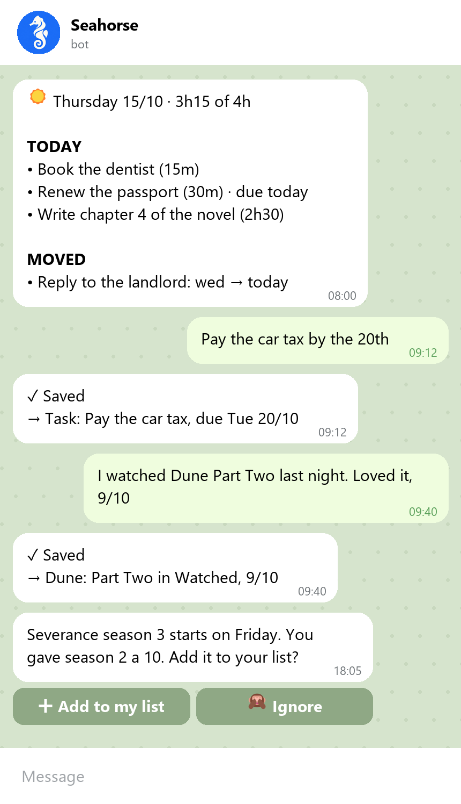

<p align="center"></p>

<h1 align="center">Seahorse</h1>

<p align="center">Your second brain on Telegram and Obsidian.<br>You capture. AI agents organize, plan your week, and talk to you first.</p>

<p align="center"></p>

## What it does

- **You only capture.** Send a text or a voice note on Telegram, or write a note in Obsidian.
- **Agents do the rest.** They file each capture, link it to what you know, and make tasks.
- **It plans your week.** Tasks fit in your free hours. A task that you do not do moves to the next free day.
- **It talks first.** It asks about your day, tells you about new releases that you would like, and reminds you of real deadlines.
- **Your notes stay yours.** They are plain Markdown in your own private Git repository.

The name comes from the hippocampus, the part of the brain that makes long-term memory. In Greek, *hippocampus* means seahorse.

## The four areas

Most systems organize files. Seahorse organizes a person:

| Area | What it holds | The question |
|---|---|---|
| 🎯 **Intention** | Tasks, the week, goals, the things you want to watch, read or buy | What will I do? |
| 📓 **Memory** | Journal, trips, career, people | What happened? |
| 📚 **Knowledge** | One folder for each subject or project | What do I know? |
| 🪞 **Identity** | Profile, routine, patterns, tastes | Who am I? |

💭 **Engrams** keep each capture exactly as you sent it. ⚙️ **System** holds the rules of the agents, in plain language that you can change.

A new fact changes old notes. "I started a new job" updates your career, your routine and the people in it, not only one line.

<p align="center"></p>

## How it compares

| Method | What Seahorse adds |
|---|---|
| **GTD** | The inbox and the weekly plan run by themselves |
| **PARA** | Places for what happened and for who you are, not only for projects |
| **Zettelkasten** | The agents make the links. You do not file or link by hand |
| **Building a Second Brain** | You only capture. The agents organize, distill, and bring ideas back to you |
| **"Chat with your notes" tools** | It does not wait for questions. It keeps the notes current and talks first |

## Install

You need:

- **Telegram** on your phone.
- **Claude or ChatGPT**: a subscription or an API key.
- **A machine that is always on**: a small server (about US$5 a month), or your own computer. See [where Seahorse runs](docs/server.md).
- **GitHub** (free, optional): to open your notes on your phone.

Run the install on your own computer, also when Seahorse will run on a server.

Windows (PowerShell):

```powershell
irm https://raw.githubusercontent.com/lorenzoa7/seahorse/main/install.ps1 | iex
```

macOS and Linux:

```bash
curl -fsSL https://raw.githubusercontent.com/lorenzoa7/seahorse/main/install.sh | bash
```

<p align="center"></p>

The setup asks one thing at a time, in English, Portuguese or Spanish, in about 15 minutes. It opens each login in your browser and copies the codes for you. At the end, Seahorse sends you a message, and your notes open in Obsidian.

## Use it

- **Capture**: "Pay the car tax by the 20th", "I watched Dune, 9/10", "Idea: an offline mode for the app".
- **Ask**: "When is my dentist appointment?"
- **See the week**: send `week`, or `today`.

<p align="center"></p>

## Learn more

- [Where Seahorse runs](docs/server.md): rent a server, two people on one server, Windows.
- [Your notes on other devices](docs/phone.md): your phone and other computers.
- [Reference](docs/reference.md): the agents, commands, settings, updates, uninstall, privacy.
- [Changelog](CHANGELOG.md)

## Contributing

Issues and pull requests are welcome. To run the tests:

```bash
uv run python -m unittest discover -s tests
```

To try your copy on a server before a release, install it with `uv tool install --editable .`, and run the setup with `SEAHORSE_SOURCE` set to its folder.

## License

MIT
