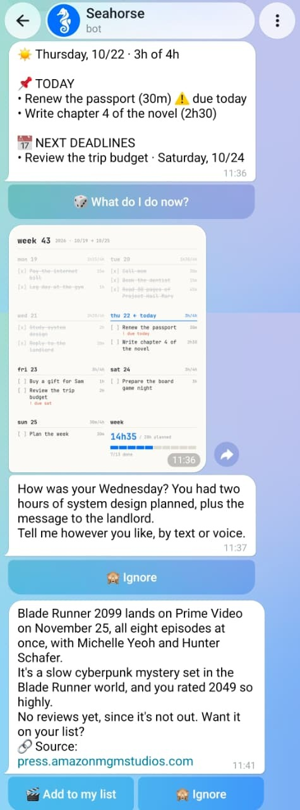
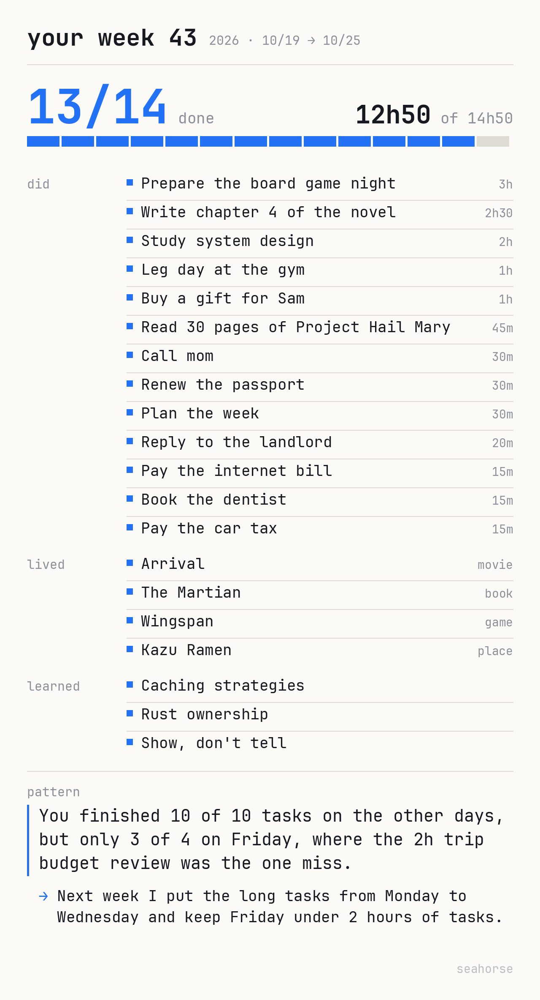
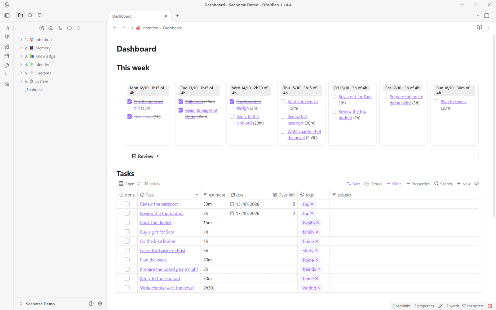
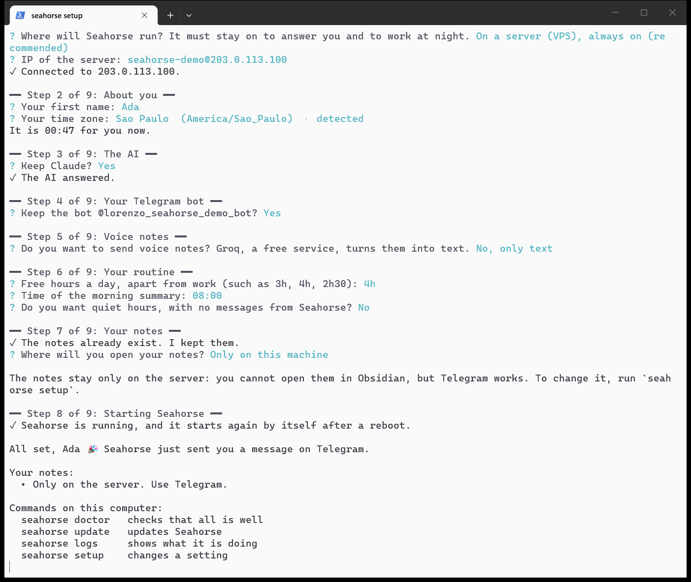

<p align="center"></p>

<h1 align="center">Seahorse</h1>

<p align="center"><b>Seahorse learns who you are.</b><br>Tell it about your day. It keeps a living map of your mind: what you will do, what happened, what you know, and who you are. And it comes back to you, like a friend who remembers.</p>

https://github.com/user-attachments/assets/75493de2-c7e5-4c2d-a048-6ee58c98bcbf

## A second brain that is a brain

Most second brains are notebooks. They are a way to file notes, save links and list tasks. You do the work, and they wait for you.

A real brain does more. It keeps memories, connects them, and brings them back when they matter.

Seahorse is that kind of second brain. It is an agent that learns who you are, connects what you tell it, plans your week, reminds you of what matters, and talks to you first.

## What it does

- **You talk to it.** Send a text or a voice note on Telegram, or write a note in Obsidian.
- **It organizes your life.** It puts each message in one of [four areas](#the-four-areas), and links it to what you told it before.
- **It plans your week.** Tasks fit in your free hours. A task that you do not do moves to the next free day.
- **It talks to you first.** It asks about your day, tells you about new releases that you would like, and reminds you of real deadlines.
- **It remembers people.** It keeps the stories of the people in your life. It brings them back before a birthday, before you meet someone, and when someone important has been quiet for too long.
- **It helps you start.** Tell it "I have 30 minutes". It picks one task that fits, says why, and later asks if you finished.
- **It shows you your week.** Every Sunday, one image: what you did, lived and learned, and one pattern it noticed.
- **Your notes stay yours.** They are plain Markdown in your own private Git repository.

<p align="center">&nbsp;&nbsp;</p>

## The four areas

Most systems organize files. Seahorse organizes a person:

| Area | What it holds | The question |
|---|---|---|
| 🎯 **Intention** | Tasks, the week, goals, the things you want to watch, read or buy | What will I do? |
| 📓 **Memory** | Journal, trips, career, people | What happened? |
| 📚 **Knowledge** | One folder for each subject or project | What do I know? |
| 🪞 **Identity** | Profile, routine, patterns, tastes | Who am I? |

Each message becomes an **engram**: a copy of the message, exactly as you sent it. Then Seahorse does the work of the hippocampus, the part of the brain that makes long-term memory. It puts the engram in the area where it belongs, and links it to what is already there. In Greek, *hippocampus* means seahorse.

| You send | It goes to | It becomes |
|---|---|---|
| "Pay the car tax by the 20th" | 🎯 Intention | A task, due Tuesday, in your week |
| 🎤 "Watched Dune: Part Two last night. Loved it, 9 out of 10." | 📓 Memory | A movie that you watched, with your rating |
| "TIL: in Rust, each value has one owner" | 📚 Knowledge | A note in the Dev folder |
| "I focus best in the morning" | 🪞 Identity | A change to your routine |

A new fact changes old notes. "I started a new job" updates your career, your routine and the people in it, not only one line.

💭 **Engrams** holds all your messages, as you sent them. ⚙️ **System** holds the rules of the agents, in plain language that you can change.

<p align="center"></p>

## How it compares

| Method | What Seahorse adds |
|---|---|
| **GTD** | The inbox and the weekly plan run by themselves |
| **PARA** | Places for what happened and for who you are, not only for projects |
| **Zettelkasten** | The agents make the links. You do not file or link by hand |
| **Building a Second Brain** | You only capture. The agents organize, distill, and bring ideas back to you |
| **"Chat with your notes" tools** | It does not wait for questions. It keeps the notes current and talks first |

## Install

Before you start, have these ready:

- **Telegram** on your phone.
- **Claude or ChatGPT**: a subscription or an API key.
- **A machine that is always on**, one of these:
  - **A server** with Ubuntu (about US$5 a month): its IP, and its password or key file. Rent it before you start. See [where Seahorse runs](docs/server.md).
  - **Your own computer**: macOS or Linux. On Windows, only inside WSL. Seahorse works only while the computer is on.
- **GitHub** (free, optional): to open your notes on your phone and on other computers.

Run the install on your own computer, also when Seahorse will run on a server. The install needs no git and no Python: it installs what it needs.

Windows (PowerShell):

```powershell
irm https://raw.githubusercontent.com/lorenzoa7/seahorse/main/install.ps1 | iex
```

macOS and Linux:

```bash
curl -fsSL https://raw.githubusercontent.com/lorenzoa7/seahorse/main/install.sh | bash
```

<p align="center"></p>

The setup asks one thing at a time, in English, Portuguese or Spanish, in about 15 minutes. It opens each login in your browser and copies the codes for you. At the end, Seahorse sends you a message, and your notes open in Obsidian.

The setup saves each answer at once. If you stop it (Ctrl+C), or if a step fails, run `seahorse setup` again: it continues from your answers. When a step fails, the setup shows the error and says what to do.

## Use it

- **Capture**: "Pay the car tax by the 20th", "I watched Dune, 9/10", "Idea: an offline mode for the app". A voice note, a photo, a PDF, a location or a contact works too.
- **Correct**: edit the message that you sent. Seahorse corrects what it filed.
- **Ask**: "When is my dentist appointment?" Questions about the world get an answer from the web, with its source.
- **Start something**: "I have 30 min", or `/now`.
- **See the week**: send `week` or `today`. Send `retro` for this week in one image, and `retro last week` for the week before.

<p align="center"></p>

## Commands

| On Telegram | What it does |
|---|---|
| `week`, `today` | The week, or today, as an image |
| `/now`, "I have 30 min" | One task for the time you have. Later, it asks if you finished |
| `/retro`, `retro` | This week in one image. `/retro last week` shows the week before |
| `/plan` | Plans this week again, from today on |
| `/status` | The captures that wait, and the version |
| `/integrate` | Integrates the waiting captures now |
| `/update` | Installs the newest version |
| `/help` | What Seahorse does, and the commands |
| `/intro` | Asks the first questions again, to get to know you |

| In the terminal | What it does |
|---|---|
| `seahorse setup` | Sets up Seahorse, or changes a setting |
| `seahorse version` | The version here, on the server, and the newest release |
| `seahorse doctor` | Checks each part and says what to fix |
| `seahorse status` | Shows what runs |
| `seahorse logs` | Shows what Seahorse does now |
| `seahorse update` | Installs the newest version |
| `seahorse uninstall` | Removes Seahorse. Your notes stay |

On the computer that set up a server, the terminal commands act on the server.

## Learn more

- [Where Seahorse runs](docs/server.md): rent a server, two people on one server, Windows.
- [Your notes on other devices](docs/phone.md): your phone and other computers.
- [Reference](docs/reference.md): the agents, all the commands, settings, updates, uninstall, privacy.
- [Changelog](CHANGELOG.md)

## Contributing

Issues and pull requests are welcome. To run the tests:

```bash
uv run python -m unittest discover -s tests
```

To try your copy on a server before a release, install it with `uv tool install --editable .`, and run the setup with `SEAHORSE_SOURCE` set to its folder.

## License

MIT
