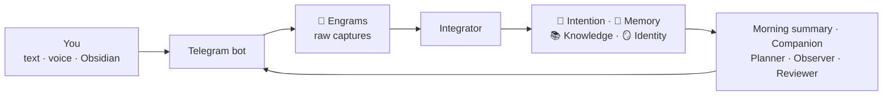

# Reference

## How it works



| Agent | When | What it does |
|---|---|---|
| **Integrator** | Seconds after each message | Files the capture in the right notes, makes tasks, and tells you in one line |
| **Notes reader** | Every 5 minutes | Reads the notes you write in Obsidian after 15 quiet minutes, and links them. It never changes your text |
| **Morning summary** | Each morning | Today's tasks, moved tasks, next deadlines, and the week as an image |
| **Companion** | 1 to 4 times a day, and at night | Asks about your day, tells you about releases and news you would like, asks about quiet projects and stuck tasks |
| **Messenger** | Every 10 minutes | Sends deadline reminders. Never in your quiet hours |
| **Planner** | Sunday | Makes the next week from your tasks and your free hours |
| **Observer** | Sunday | Finds patterns and updates Identity |
| **Reviewer** | Each night | Fixes errors, merges duplicates, and checks each note against its sources |

Each claim in the vault points to the engram it came from. A trait in Identity starts as a hypothesis, becomes "supported" after three separate signals, and becomes "confirmed" only when you agree. Nothing is deleted: old understanding moves to a History section.

## Commands

| On Telegram | What it does |
|---|---|
| `week`, `today` | The week, or today, as an image (`semana` and `hoje` in Portuguese, `semana` and `hoy` in Spanish) |
| `/status` | Pending captures and the version |
| `/integrate` | Integrates the pending captures now |
| `/update` | Installs the newest version |

| In the terminal | What it does |
|---|---|
| `seahorse setup` | Sets up Seahorse, or changes a setting |
| `seahorse version` | The version here, on the server, and the newest release |
| `seahorse doctor` | Checks each part and says what to fix |
| `seahorse status` | Shows what runs |
| `seahorse logs` | Shows what Seahorse does |
| `seahorse update` | Installs the newest release |
| `seahorse agent <name>` | Runs one agent now: `integrator`, `notes`, `morning`, `reviewer`, `weekly`, `messenger` |
| `seahorse uninstall` | Removes Seahorse. The vault stays |

On the computer that set up a server, these commands run on the server.

## Settings

The setup writes two files in `~/.seahorse` on the machine that runs Seahorse:

- `config.toml`: name, language, time zone, AI, schedule and capacity.
- `secrets.env`: the tokens and keys. Only its user can read it.

```toml
[user]
name = "Ada"
language = "en"            # en, pt-BR or es
timezone = "Europe/Lisbon"

[ai]
provider = "claude"        # claude or codex

[ai.models]                # optional: a model for each tier
# fast = "haiku"
# standard = "sonnet"
# deep = "opus"

[schedule]
morning = "08:00"
reviewer = "03:30"
weekly_day = "sun"
weekly_time = "18:00"
quiet_from = "23:00"       # the same time in both: no quiet hours
quiet_until = "08:00"

[week]
daily_capacity = "4h"
work_tag = "work"          # tasks with this tag do not count in the daily hours
```

The rules of the agents are in the vault, in `6. ⚙️ System/`, in plain language. To change what an agent does, change its rule.

## Updates

When a new version is out, the bot sends its release notes once. Send `/update` or run `seahorse update`. The update installs the new code, applies the vault changes of the version, and starts Seahorse again. It never changes the text of your notes. See [CHANGELOG.md](../CHANGELOG.md).

## Uninstall

Run `seahorse uninstall` on the computer where you installed Seahorse. It stops Seahorse, deletes the program and `~/.seahorse`, and asks before it deletes the vault. On a server, it also removes the Linux user of that Seahorse when no vault stays in it. The GitHub repository, the Telegram bot and tools such as Claude Code and uv stay. The command tells you how to remove them.

## Privacy and costs

- Your vault is plain Markdown in your own Git repository. Seahorse has no server and collects no data.
- Your AI provider (Anthropic or OpenAI) gets the notes that the agents read, under the terms of your account.
- With a subscription, Seahorse uses the limits of your plan: a few dozen agent runs a day, and the deepest model once a week.
- With voice notes, Groq gets your audio to make the text.
- The setup logs in to GitHub on the server only to make the repository, then logs out. The server keeps only a deploy key for the vault. On your computer, the setup saves the GitHub login in the credential store, so Obsidian can sync.
- To suggest your time zone, the setup reads the clock of your computer. On Windows, it asks ipinfo.io once.

## Languages

The setup, the bot and the agents speak English, Brazilian Portuguese and Spanish. Folder names and agent rules stay in English. To add a language, copy `seahorse/i18n/en.toml`, translate the values, and open a pull request.
