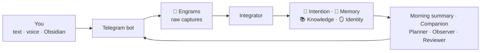

# Reference

## How it works



| Agent | When | What it does |
|---|---|---|
| **Integrator** | Seconds after each message | Files each part of the capture in the right notes, makes tasks, and tells you where each part went |
| **Notes reader** | Every 5 minutes | Reads the notes you write in Obsidian after 15 quiet minutes, and links them. It never changes your text |
| **Morning summary** | Each morning | Today's tasks, moved tasks, next deadlines, and the week as an image |
| **Companion** | 1 to 4 times a day, and each morning about yesterday | Asks about your day, tells you about releases and news you would like, asks about quiet projects and stuck tasks |
| **Messenger** | Every 10 minutes | Sends deadline reminders, the research that you asked for, and messages about people: a birthday, a meeting today, someone you want to keep in touch with. At most 5 messages a day that you did not ask for. Never in your quiet hours |
| **Retrospective** | Sunday, before the Planner | Sends your week in one image, with one pattern and the change that it makes next week |
| **Planner** | Sunday | Makes the next week from your tasks and your free hours |
| **Observer** | Sunday | Finds patterns and updates Identity |
| **Reviewer** | Each night | Fixes errors, merges duplicates, and checks each note against its sources |

Each claim in the vault points to the engram it came from. A trait in Identity starts as a hypothesis, becomes "supported" after three separate signals, and becomes "confirmed" only when you agree. Nothing is deleted: old understanding moves to a History section.

## Commands

| On Telegram | What it does |
|---|---|
| `week`, `today` | The week, or today, as an image (`semana` and `hoje` in Portuguese, `semana` and `hoy` in Spanish) |
| `/now`, "I have 30 min" | One task for the time you have. Later, it asks if you finished |
| `/retro`, `retro` | Your last week in one image |
| `/plan` | Plans this week again, from today on |
| `/status` | Pending captures and the version |
| `/integrate` | Integrates the pending captures now |
| `/update` | Installs the newest version |
| `/help` | What Seahorse does, and the commands |
| `/intro` | Asks the first questions again, to get to know you |

| In the terminal | What it does |
|---|---|
| `seahorse setup` | Sets up Seahorse, or changes one setting |
| `seahorse version` | The version here, on the server, and the newest release |
| `seahorse doctor` | Checks each part and says what to fix |
| `seahorse status` | Shows what runs |
| `seahorse logs` | Shows what Seahorse does now: the last lines, then each new line. Ctrl+C stops it |
| `seahorse update` | Installs the newest release |
| `seahorse migrate` | Applies the vault changes of this version. The update and the setup do this for you |
| `seahorse agent <name>` | Runs one agent now: `integrator`, `notes`, `morning`, `reviewer`, `weekly`, `messenger` |
| `seahorse uninstall` | Removes Seahorse. The vault stays |

You can also send photos, files of up to 10 MB, locations and contacts. To correct a message, edit it.

On the computer that set up a server, these commands run on the server. When the server cannot be reached, the command says so. Before a setup, the commands tell you to run `seahorse setup`.

## Settings

The setup writes two files in `~/.seahorse` on the machine that runs Seahorse:

- `config.toml`: name, language, time zone, AI, schedule and capacity.
- `secrets.env`: the tokens and keys. Only its user can read it.

```toml
[user]
name = "Ada"
language = "en"            # en, pt-BR or es
timezone = "Europe/Lisbon"

[ai]
provider = "claude"        # claude or codex

[ai.models]                # optional: a model for each tier
# fast = "haiku"
# standard = "sonnet"
# deep = "opus"

[schedule]
morning = "08:00"
reviewer = "03:30"
weekly_day = "sun"
weekly_time = "18:00"
quiet_from = "23:00"       # the same time in both: no quiet hours
quiet_until = "08:00"

[week]
daily_capacity = "4h"
work_tag = "work"          # tasks with this tag do not count in the daily hours

[messenger]
daily_messages = 5         # the most messages that Seahorse starts in one day

[obsidian]
vault = "Seahorse"         # the name of the vault in Obsidian on your computer, for "Open in Obsidian" links
```

- `[obsidian] vault`: the setup writes it at step 9, with the name of the folder on your computer. Without it, Seahorse uses the name of the vault folder on the machine that runs it.
- When you run the setup again, it keeps the settings that it does not ask about, and tables such as `[ai.models]`.
- When `config.toml` has an error, each command shows the file, the line and the error. To write a good file again, run `seahorse setup`.

To change one setting, run `seahorse setup`, and choose the step to change. The setup then starts Seahorse again with the new setting.

The rules of the agents are in the vault, in `6. ⚙️ System/`, in plain language. To change what an agent does, change its rule.

## Updates

When a new version is out, the bot sends its release notes once. The notes are in English: in other languages, the bot sends a link to them. Send `/update` or run `seahorse update`. The update:

1. Installs the new code.
2. Applies the vault changes of the version. It adds the template files that are new in the version. A file that you deleted does not come back. It never changes the text of your notes.
3. Starts Seahorse again, and checks for 20 seconds that Seahorse stays on.

If a step fails, the update puts the previous version back, and tells you on Telegram. When you run the install command again to get a new version, the setup applies the vault changes too. See [CHANGELOG.md](../CHANGELOG.md).

## Uninstall

Run `seahorse uninstall` on the computer where you installed Seahorse. It stops Seahorse, deletes the program and `~/.seahorse`, and asks before it deletes the vault. On a server, it also removes the Linux user of that Seahorse when no vault stays in it. The GitHub repository, the Telegram bot and tools such as Claude Code and uv stay. The command tells you how to remove them.

## Privacy and costs

- Your vault is plain Markdown in your own Git repository. Seahorse has no server and collects no data.
- Your AI provider (Anthropic or OpenAI) gets the notes that the agents read, under the terms of your account.
- With a subscription, Seahorse uses the limits of your plan: a few dozen agent runs a day, and the deepest model once a week.
- With voice notes, Groq gets your audio to make the text.
- The agents work only in your vault. With Claude, they cannot read the Seahorse secrets, the AI logins or your ssh keys, also when a web page or a forwarded text tells them to. With Codex, the sandbox cannot block reads outside the vault: on a server that other people use too, choose Claude.
- The setup logs in to GitHub on the server only to make the repository, then logs out. The server keeps only a deploy key for the vault. On your computer, the setup saves the GitHub login in the safe credential store of the system (the Windows Credential Manager, or the macOS keychain), so Obsidian can sync. It never writes the login to a plain file, and it never puts the login in a command line.
- To connect to a server, the setup uses its own key (`~/.seahorse/server_key`) and its own list of known servers (`~/.seahorse/known_hosts`). If you give it a key file, it uses the key file once and keeps no copy.
- To suggest your time zone, the setup reads the clock of your computer. On Windows, it asks ipinfo.io once.

## Languages

The setup, the bot and the agents speak English, Brazilian Portuguese and Spanish. Folder names and agent rules stay in English. To add a language, copy `seahorse/i18n/en.toml`, translate the values, and open a pull request.
